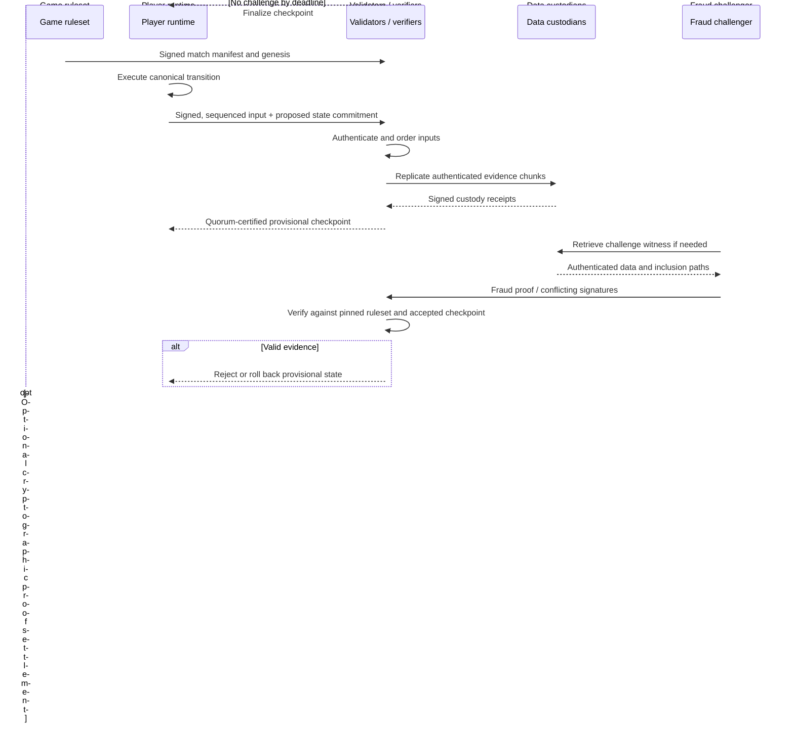

# 03 — Components, boundaries, and data flow

## High-level sequence

## Trust boundaries

**The game** owns authoritative transition semantics, input limits, collision data and visibility. **The SDK** owns cryptographic primitives, canonical transcript recording, verification procedure, evidence formats, timing/finality policy interfaces. **The network adapter** owns delivery only, never semantic acceptance. **Validators** provide order and finality under a declared fault model, not proof of physics. **Data custodians** store signed bytes and certify availability but cannot rewrite hashes. An **external storage or settlement system** may optionally hold evidence; it is never a match sequencer or referee.

## Component responsibilities

- `core`: exact match, player, state and ruleset identities, protocol versions, and bounded stable types. No I/O.
- `commitments`: collision-resistant domain-separated hashing, ordered append-only Merkle log and witnesses, commitments with private nonces.
- `transcript`: sign/verify authentic input records, enforce per-player ordering, serialize canonical leaf bytes. Application must additionally enforce global input order.
- `replay`: pure deterministic `F(S,I)` and a verifier comparing authenticated state openings to the accepted claim.
- `fraud`: minimal self-contained evidence, validation of roster/QC, input membership, opening, executable invalid transition, and result classification; extend to minimized witnesses/interactive bisection later.
- `consensus`: agreed ordering, quorum certificates, timeout/view-change, irrevocable lock records, availability quorum, challenge/finality. **Only QC verification is currently implemented.**
- `privacy`: per-observer disclosure policy, ephemeral encrypted content, commit/reveal, selective disclosure, minimized evidence publication, deletion and retention. **Only reveal commitment check currently implemented.**
- `zk`: proof-system-neutral claim with pinned program identity, deterministic output statement, bounded proof bytes. Optional RISC Zero / Groth16 backend after interoperability tests. **Currently disabled.**
- `sdk`: game integration interface and policy configuration for C/Rust/WASM/other engines.
- `adapters/p2p`: authenticated network transport, gossip, content-addressed chunk exchange, chunk limits, quotas and resume.
- Publishing evidence to any external storage or settlement system is an application concern built on the generic export package ([38](38-EVIDENCE-EXPORT.md)); the SDK has no such dependency.
- `adapters/wasm`: deterministic browser-compatible serialization and buffer boundaries; no JS floating-point state authority.

## Data roots

Maintain **separate** committed roots: per-player ordered input log, global canonical input batch, accepted state/checkpoint, availability manifest/chunk tree, and optional private-view commitments. Each root has a unique domain. Mixing player signatures and bare input payloads into the same implicit Merkle domain is forbidden.

## Why P2P verification and authority are different

Anyone may independently verify and publish evidence. Not everyone may decide canonical ordering/finality. For rated matches, publish the validator membership, quorum and challenge policy in the match manifest before play. Two players without an impartial arbiter can demonstrate disagreements but cannot compel an adversary to accept or honor a verdict. Publishing a commitment anywhere is an optional publicly observable escalation channel; it does not solve local match governance automatically.

## Integration strategy

Adapters must be replaceable through versioned interfaces. Never import game-specific physics into `fraud`, settlement-system client logic into `commitments`, or P2P internals into the deterministic state machine. Protocol format and behavior must be tested byte for byte across native Rust, WASM, and all game engines.

## r3 signed event batching / independent 1v1 evidence

Architecture now supports `digital controls -> canonical event codec -> signed player batch -> canonical multi-match aggregate -> node-budgeted inline chain chunks OR off-chain Merkle/custody`; fraud verification remains separate from BFT admission and chain settlement. Full details in [r3 packing and decentralized 1v1](22-INPUT-PACKING-AND-DECENTRALIZED-1V1.md).
